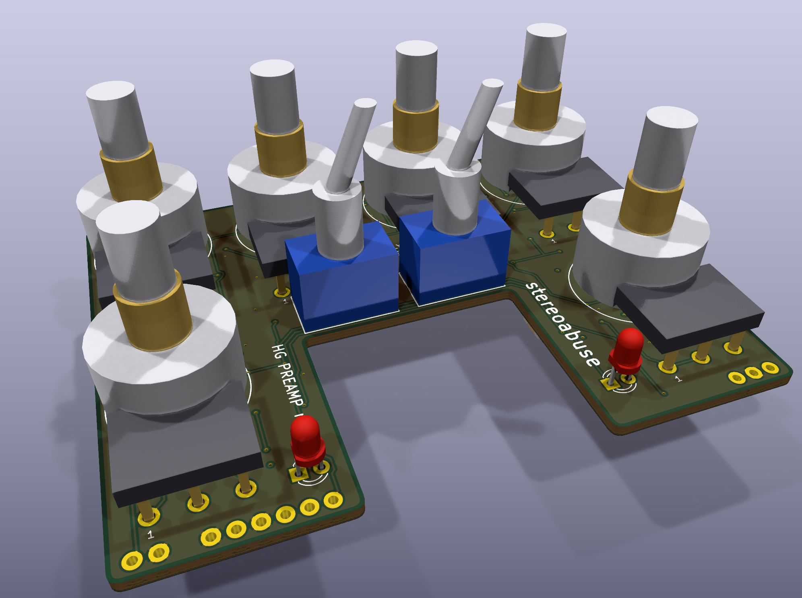
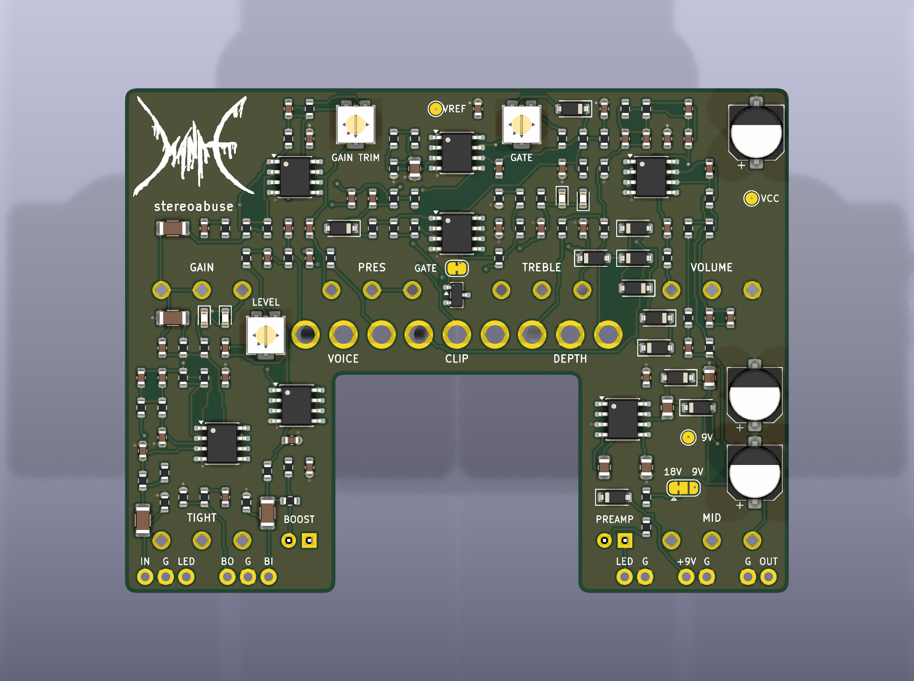

# hg-preamp

High-gain preamp pedal by stereoabuse. Derived from the Friedman BE-OD circuit (via the public PedalPCB "Thermionic Distortion" schematic), reworked for downtuned rhythm playing and for driving a power-amp input.

Rev A. Untested hardware: the circuit is simulated and the board passes KiCad DRC, but no board has been built yet.

## What it is

| Control | Type | Notes |
|---|---|---|
| Gain | A1M pot | Audio taper, so the sweep is more usable than the stock linear pot |
| Tight | C100K pot | Bass cut before the gain stages, about 75 Hz to 1.7 kHz |
| Presence | C10K pot | Stock BE-OD presence |
| Treble | B100K pot | Stock |
| Mid | B100K pot | New. About +/-13 dB centred near 750 Hz |
| Volume | A10K pot | Low output impedance for power-amp inputs |
| Depth | SPDT on-off-on | Post-distortion low thump: flat, +6 dB, +10 dB around 90 Hz |
| Clip | SPDT on-off-on | Stock soft clip, none (open), single diode pair (saturated) |
| Bypass | 3PDT footswitch | True bypass |
| Boost | 3PDT footswitch | TS-style tightening boost into the first stage, up to +12 dB above 700 Hz |

Inside: gain trim (stock), boost level trim, noise gate threshold trim, and two solder jumpers (18 V or 9 V rail, gate on or off).

Differences from the BE-OD: no Bass knob (Tight and Depth cover it), added Mid, boost, noise gate, clip switch, and an internal charge pump that runs the op-amps at about 16 V from a 9 V supply or battery.

## Ordering from JLCPCB

Files are in [fab/](fab/).

1. Upload `hg-preamp-revA-gerbers.zip`. Settings: 4 layers, 1.6 mm, 82 x 62.5 mm. Layer order is F, In1, In2, B (`.gtl`, `.g1`, `.g2`, `.gbl`).
2. Turn on PCB Assembly, top side.
3. Upload `hg-preamp-revA-bom.csv` and `hg-preamp-revA-cpl.csv`.
4. In the placement preview, check pin 1 on U1 to U6, the two JFETs (Q1, Q2), the diode cathode bars, and the stripe on C20, C27, C28. JLC's rotation convention differs from KiCad's for some packages; the CPL already applies the usual corrections, but this is the step to catch a mistake.

40 BOM lines, 120 placements. 11 of the lines are JLC "extended" parts (a small one-time fee each). Stock was checked on 2026-11-11.

## Parts you solder

| Part | Qty | Notes |
|---|---|---|
| Alpha 16 mm right-angle PCB pot (RV16AF-41) | 6 | A1M, C100K, C10K, B100K x2, A10K |
| Mini toggle, SPDT on-off-on | 2 | Solder lug or PC pin, 4.7 mm lug pitch |
| 3PDT footswitch | 2 | Wired, not board mounted |
| 3 mm LED | 2 | Any colour |
| 1/4" jack | 2 | Input must be stereo (battery switching) |
| 2.1 mm DC jack with switch lug | 1 | Panel mount, insulated |
| 9V battery snap | 1 | |
| Hammond 1590BB enclosure | 1 | |

Pots, toggles and LEDs mount on the back of the board (the side with the pot outlines). Fit them loosely, bolt everything into the drilled enclosure, then solder, so the heights settle correctly.

Drill template (front view, 1:1): [docs/drill-template-1590BB.svg](docs/drill-template-1590BB.svg). Hole positions in mm from the face centre:

| Hole | x | y | dia |
|---|---|---|---|
| Volume | -31.5 | +23.0 | 7.5 |
| Treble | -10.5 | +23.0 | 7.5 |
| Presence | +10.5 | +23.0 | 7.5 |
| Gain | +31.5 | +23.0 | 7.5 |
| Depth | -8.0 | +1.5 | 6.5 |
| Clip | +8.0 | +1.5 | 6.5 |
| Mid | -31.5 | -8.0 | 7.5 |
| Tight | +31.5 | -8.0 | 7.5 |
| Boost LED | -19.5 | -24.0 | 3.2 |
| Bypass LED | +19.5 | -24.0 | 3.2 |
| Boost switch | -27.0 | -43.0 | 12.5 |
| Bypass switch | +27.0 | -43.0 | 12.5 |

The toggles sit sideways (levers move left and right). The battery lies between the footswitches in the board's notch. That fit is snug: check it with a real battery before drilling.

## Wiring

Pads are labelled on the SMD side. Looking at the SMD side, the left leg (IN, G, L1) is next to the bypass switch.

Bypass switch (3PDT, columns A B C, row 2 is the common):

| Lug | Goes to |
|---|---|
| A1 | board IN |
| A2 | input jack tip |
| A3 | wire to B3 |
| B1 | board OUT |
| B2 | output jack tip |
| C1 | board L1 (left leg) |
| C2 | board G |
| C3 | board IN (grounds the input when bypassed) |

Boost switch:

| Lug | Goes to |
|---|---|
| A2 | board BST |
| A3 | board G |
| B1 | board L1 (right leg) |
| B2 | board L2 |

The boost is on when BST is left open and off when BST is grounded. Wired as above, the boost LED only lights when the pedal is engaged.

Power: DC jack centre pin to G, DC jack sleeve to +9V, battery red to the DC jack switch lug, battery black to the input jack ring lug, input jack sleeve to G.

Use a regulated 9 V centre-negative supply only. The charge pump chip is rated to 12 V, and there is no over-voltage clamp.

## Setting the trimmers

- GAIN TRIM: sets how hard the last gain stage is driven. Start at halfway.
- BST LVL: boost amount and voicing. One end is a tight mid/treble push, the other a mild full-range lift.
- GATE: threshold. Turn until hiss cuts off when you mute the strings but sustained notes do not chop.

Toggle positions as designed (seen from the front): Clip lever left is stock, centre is open, right is saturated. Depth lever left is medium, centre is flat, right is deep. If a switch you buy works the other way round, turn it 180 degrees.

## If something misbehaves

- Gate causes trouble: cut the GATE solder jumper. The gate is then out of circuit.
- Whine from the charge pump: cut the 18V side of the 18V/9V jumper and bridge the 9V side. If you run on the 9 V rail, also cut the GATE jumper, because the gate needs the higher rail to switch cleanly.
- Test pads: VCC should read about 16 V, VREF about half that, 9V about 8.7 V.

## How the board was made

Everything is generated from [hw/design.py](hw/design.py), which holds the full netlist with JLC part numbers.

## Schematic

[docs/schematic.pdf](docs/schematic.pdf), five sheets. It is drawn by `hw/schematic.py`, which extracts the connectivity of the drawing and refuses to write it unless every pin matches the board netlist, so the drawing and the board cannot drift apart. It is a drawing, not a KiCad schematic file.

| Sheet | Contents |
|---|---|
| [1](docs/schematic-1.png) | Power, voltage doubler, VREF, indicator LEDs |
| [2](docs/schematic-2.png) | Input stage, boost, Tight, gain stage |
| [3](docs/schematic-3.png) | Clip stage, gain trim, Presence, hard clip, gate switch |
| [4](docs/schematic-4.png) | Treble, Depth, Mid, output |
| [5](docs/schematic-5.png) | Noise gate sidechain |

Regenerate with `uv run --with matplotlib python3 hw/schematic.py`.

## Scripts

| Step | Script |
|---|---|
| Simulate the netlist in ngspice | `sim/from_design.py` |
| Draw and verify the schematic | `hw/schematic.py` |
| Place parts | `hw/place.py` |
| Build the KiCad board | `hw/build_pcb.py` |
| Route (own grid router) | `hw/route.py` |
| Apply tracks, fill planes, DRC | `hw/apply_routes.py`, `hw/drc.sh` |
| Gerbers, BOM, CPL, renders | `hw/export.py` |

`hw/make.sh` runs place through DRC. The board file is [hw/pedal.kicad_pcb](hw/pedal.kicad_pcb). Part positions with reference designators: [docs/assembly-smd-side.pdf](docs/assembly-smd-side.pdf).

## Things to check before paying

1. Open `hw/pedal.kicad_pcb` in KiCad and look it over.
2. Pot footprint: 3 pins at 5.0 mm pitch, 16 mm below the shaft, taken from the Alpha RV16AF-41 drawing. Confirm against the pots you buy.
3. Toggle lug pitch (4.7 mm) against the switches you buy.
4. Battery fit in the 1590BB.
5. The routing was done by a simple autorouter. It passes DRC with zero violations and the input stage is kept well away from the high-level nodes, but a high-gain layout can still squeal at maximum gain. The Gain Trim is the first thing to back off if it does.
