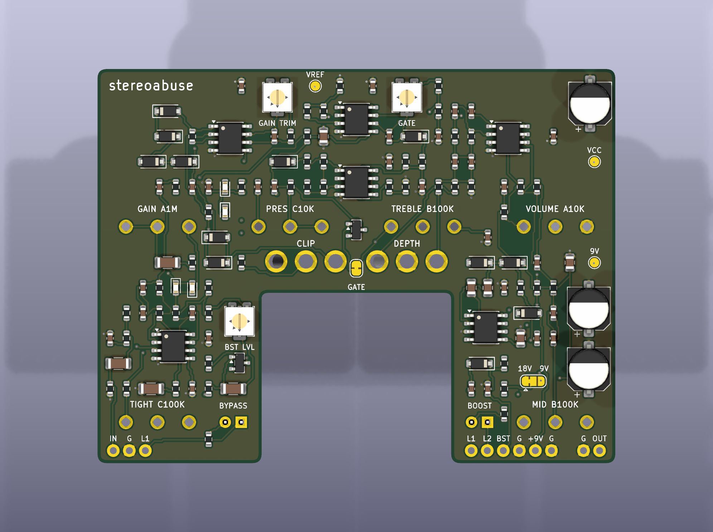
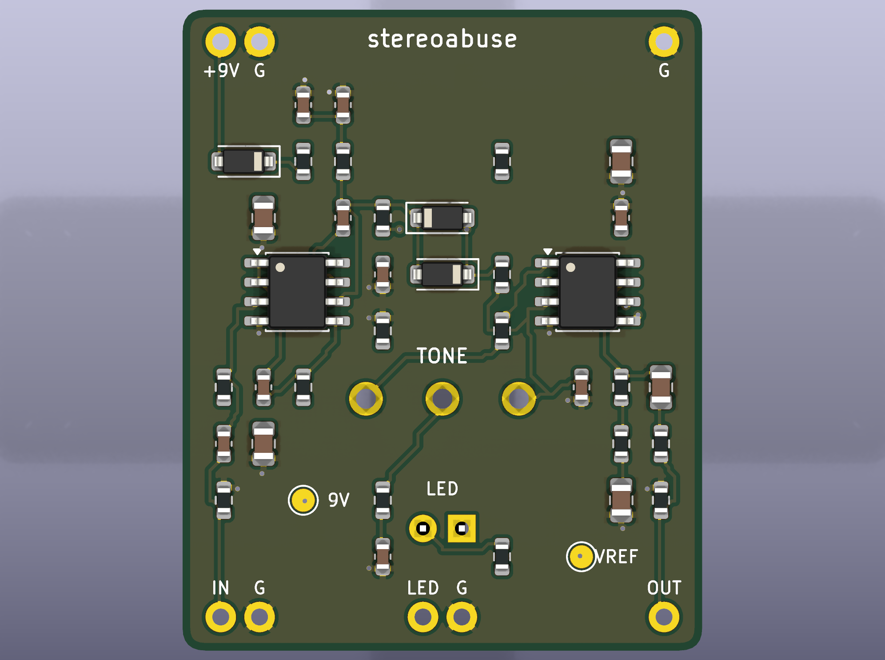

# pedals

Guitar pedal boards by stereoabuse. Each folder is a complete, separate design: netlist, board, JLCPCB fabrication files, schematic, and build notes. None has been built yet.

| Design | What it is | Enclosure |
|---|---|---|
| [preamp](preamp/) | High-gain preamp with a boost built into its first stage | 1590BB |
| [boost-preamp](boost-preamp/) | Boost and high-gain preamp as two sections in series, for the band Manat | 1590BB |
| [screamer](screamer/) | One-knob overdrive: a Tube Screamer with Drive at zero and Level at maximum, Tone only | 1590B2 |

All three run from a 9 V supply or a battery.

## The two preamps

Both are derived from the Friedman BE-OD circuit (via the public PedalPCB "Thermionic Distortion" schematic).

| | [preamp](preamp/) | [boost-preamp](boost-preamp/) |
|---|---|---|
| What it is | High-gain preamp with a boost built into its first stage | Boost and high-gain preamp as two sections in series, for the band Manat |
| Footswitches | Bypass, Boost (boost only works with the preamp on) | Preamp, Boost (each works on its own) |
| Knobs | Gain, Volume, Tight, Mid, Treble, Presence | Same |
| Toggles | Depth, Clip | Depth, Clip, Voice (boost voicing) |
| Boost | Up to +12 dB above 700 Hz | Unity to +21 dB, three voicings |
| Fab files | [preamp/fab](preamp/fab/) | [boost-preamp/fab](boost-preamp/fab/) |

| preamp | boost-preamp |
|---|---|
|  |  |

## screamer

`tools/jlc.py` looks up JLCPCB part stock and prices and is shared by all of them. `tools/wiring.py` draws the wiring diagram in each design's `docs/` folder.
