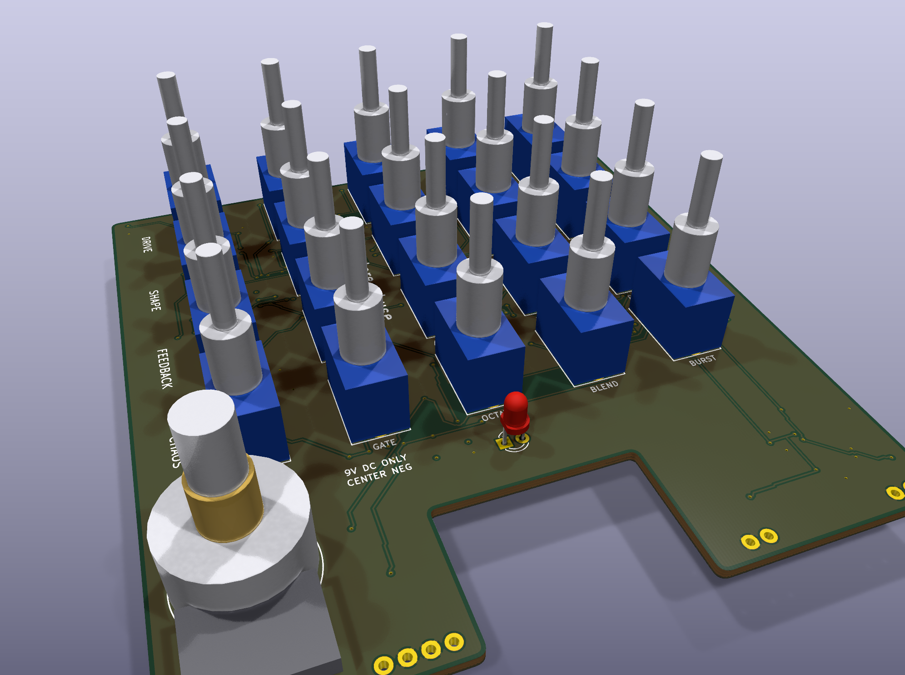
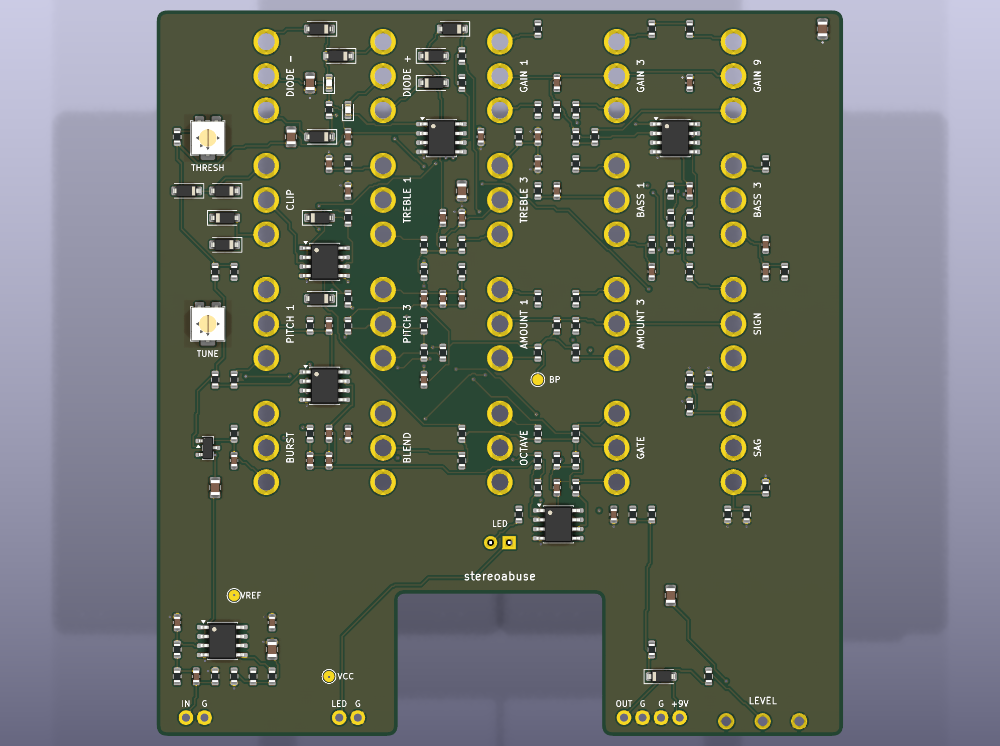
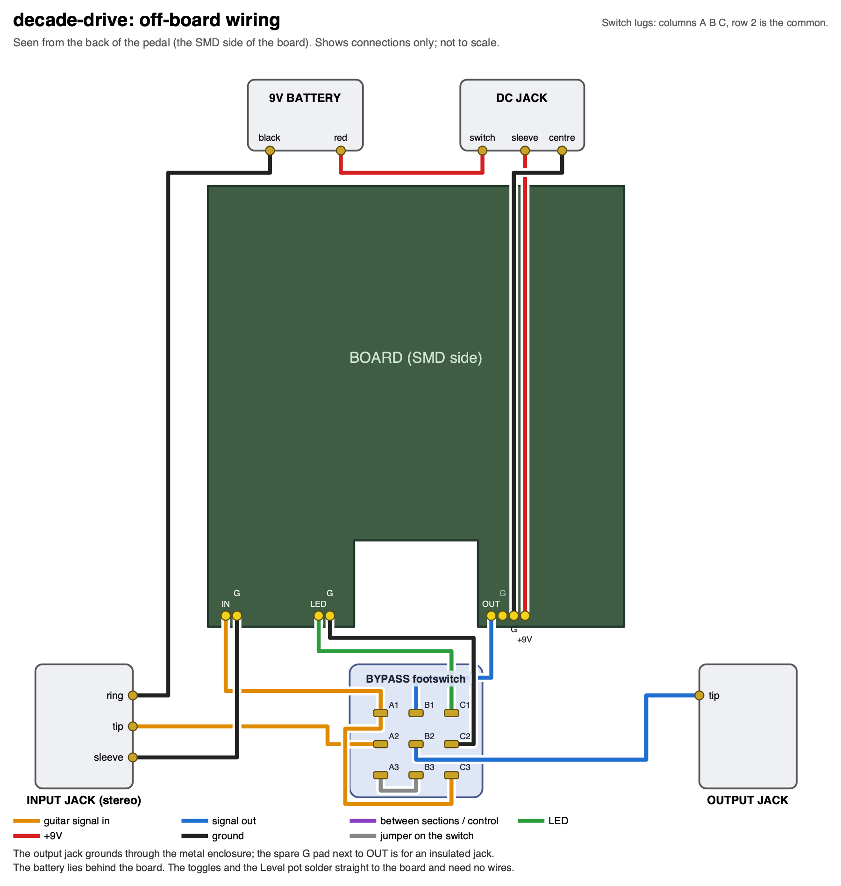

# decade-drive

A drive pedal with one knob and twenty three-way toggles, by stereoabuse. The idea comes from a decade resistance box: instead of turning a pot, you add fixed, weighted parts with switches, so every setting is a pattern you can write down and get back to exactly. That includes the feedback section, which can sit just under, on, or over the edge of oscillation at a tuned pitch.

Commands below are run from inside this folder. Untested hardware: the circuit is simulated and the board passes KiCad DRC, but no board has been built yet. The Feedback and Chaos rows in particular are designed from simulation and will want adjusting by ear.

## How the toggles work

Every toggle is an SPDT on-off-on with its centre lug on a circuit node. Lever up connects one extra part to that node, lever down connects a different one, centre connects nothing. With all twenty centred the pedal is its plain "home" sound: a mid-gain overdrive with a 720 Hz bass cut, soft red-LED clipping and no feedback.

Where a row has toggles numbered 9, 3 and 1 (or 3 and 1), they do the same job with those weights, like the dials of a decade box: 9 is the coarse step, 1 the fine one, and they add up.

Seen from the front:

| Row | 1 | 2 | 3 | 4 | 5 |
|---|---|---|---|---|---|
| Drive | GAIN 9 | GAIN 3 | GAIN 1 | DIODE + | DIODE - |
| Shape | BASS 3 | BASS 1 | TREBLE 3 | TREBLE 1 | CLIP |
| Feedback | SIGN | AMOUNT 3 | AMOUNT 1 | PITCH 3 | PITCH 1 |
| Chaos | SAG | GATE | OCTAVE | BLEND | BURST |

Below the grid: Level knob (left), LED and bypass footswitch (centre).

## What each toggle does

Numbers are from the simulation (see below), not measurements.

| Toggle | Up | Centre (home) | Down |
|---|---|---|---|
| GAIN 9 | +15 dB | 0 dB | -15 dB |
| GAIN 3 | +9 dB | 0 dB | -9 dB |
| GAIN 1 | +4 dB | 0 dB | -4 dB |
| DIODE + | Silicon | Red LED | Schottky |
| DIODE - | Silicon | Red LED | Schottky |
| BASS 3, BASS 1 | More bass | 720 Hz cut | Less bass |
| TREBLE 3, TREBLE 1 | Brighter | 3.4 kHz roll-off | Darker |
| CLIP | Silicon hard clipper | Off | Schottky hard clipper |
| SIGN | Regenerative: resonance, then oscillation | No feedback | Degenerative: a scoop |
| AMOUNT 3, AMOUNT 1 | More feedback | | Less feedback |
| PITCH 3 | Octave up | D | Octave down |
| PITCH 1 | Up three semitones (F) | D | Down five (A) |
| SAG | Drive op-amp on about 6.3 V | Full supply | About 5.6 V |
| GATE | Gate | Off | Soft gate |
| OCTAVE | Octave up, into the drive | Off | Rectified signal into the mix |
| BLEND | Clean, in phase | Off | Clean, out of phase |
| BURST (momentary) | Drone burst while held | | Kill while held |

Gain steps add up to 18 dB either side of home. The gain stage sits before a fixed 23 dB drive stage, so total gain runs from about 5 to 42 dB.

DIODE + and DIODE - each pick the soft-clipping diode for one half of the wave, so mixed settings clip asymmetrically. For a 0.2 V peak-to-peak input at home gain the drive stage puts out about 2.0 V peak-to-peak on LEDs, 0.9 V on silicon and 0.35 V on Schottky, so expect to move the Level knob when you change diodes.

Bass corner in Hz (the frequency below which the drive stage is fed less signal):

| BASS 3 \ BASS 1 | up | centre | down |
|---|---|---|---|
| up | 72 | 92 | 135 |
| centre | 227 | 725 | 1065 |
| down | 560 | 1790 | 2130 |

Treble corner in Hz:

| TREBLE 3 \ TREBLE 1 | up | centre | down |
|---|---|---|---|
| up | 9400 | 7900 | 3900 |
| centre | 4900 | 3400 | 1700 |
| down | 1190 | 820 | 660 |

## The Feedback row

A band-pass filter (the resonator) listens to the drive stage's output, and SIGN decides what happens to what it hears.

- SIGN up feeds it back in phase. Below a loop gain of 1 this is a resonant peak at the resonator's pitch, like a parked wah. Above 1 the pedal oscillates at that pitch: a drone.
- SIGN down feeds it back out of phase, which takes a few dB out around that pitch. This path runs through the bass filter, so the scoop is deepest with BASS up (about 10 dB) and shallow with BASS down (about 3 dB).
- AMOUNT sets the loop gain. With the THRESH trimmer at mid travel the simulated values are:

| AMOUNT 3 \ AMOUNT 1 | up | centre | down |
|---|---|---|---|
| up | 1.51 | 1.44 | 1.14 |
| centre | 1.13 | 0.79 | 0.50 |
| down | 0.49 | 0.28 | 0.23 |

So at home AMOUNT the pedal is just under the edge (a 13 dB peak), and one click of AMOUNT 1 up tips it over. THRESH scales the whole table by roughly 0.6 to 2.8, which is how you put the edge exactly where you want it.

- PITCH sets the resonator. Home is D5 (587 Hz). The nine settings are the notes of a D minor chord over three octaves: A3, D4, F4, A4, D5, F5, A5, D6, F6 (220 Hz to 1.4 kHz). PITCH 3 moves by octaves, PITCH 1 picks D, F or A. The TUNE trimmer moves all nine together, from about A4 to F5 at the home setting, so the set can be retuned to another root within that range.
- BURST up forces a drone at the current pitch while held, whatever SIGN and AMOUNT are doing. BURST down mutes the output while held.

Three things worth knowing:

1. While you play, the note holds the drive stage and the drone stays out of the way. As the note decays the drone takes over. More gain keeps the note in charge for longer. This is the simulated behaviour for a single decaying note; chords and real pickups will be messier.
2. The loop gain does not change with the GAIN, BASS or TREBLE toggles. It does drop to roughly a third with Schottky diodes selected, because they leak across the drive stage.
3. The drone runs at the drive stage's clipping level, so at full Level it is loud (about 4 V peak-to-peak on LEDs).

### Setting the two trimmers

Both are on the SMD side, reachable with the back off.

1. TUNE: centre both PITCH toggles, hold BURST up, and adjust TUNE until a tuner on the output reads D. The BP test pad carries the resonator output if you would rather measure there.
2. THRESH: SIGN up, both AMOUNT toggles centred, nothing plugged in. Turn THRESH until the drone just stops. AMOUNT 1 up should then start it again.

The intervals between PITCH settings come from part ratios and should land within about a third of a semitone of each other. The absolute pitch depends on capacitor tolerance, which is what TUNE is for.

## The Chaos row

- SAG lowers the supply of the drive op-amp only. Up clips the positive half earlier; down leaves so little headroom that the positive half is cut off almost completely. What a TL072 really does this close to its limits is not in the simulation model, so treat this one as an experiment. Each SAG position draws about 20 to 25 mA extra. The octave rectifier shares that op-amp, so OCTAVE behaves differently while SAG is engaged.
- GATE subtracts a limited copy of the signal from itself after the clipper, which cancels anything small. Up is a full gate: anything under roughly 0.1 V peak-to-peak at that point is cut by 15 dB or more, so hiss and the tail of a note go. Down cancels half as much.
- OCTAVE up full-wave rectifies the signal before the drive stage, which doubles its frequency. Down adds the half-wave rectified clean signal to the output instead; with BLEND down as well the clean part becomes fully rectified.
- BLEND adds clean signal (after the gain stage) to the output, in or out of phase with the driven signal. With OCTAVE up, the in-phase clean signal is the rectified one.

## Ordering from JLCPCB

Files are in [fab/](fab/).

1. Upload `decade-drive-revA-gerbers.zip`. Settings: 4 layers, 1.6 mm, 94 x 99.5 mm. Layer order is F, In1, In2, B (`.gtl`, `.g1`, `.g2`, `.gbl`).
2. Turn on PCB Assembly, top side.
3. Upload `decade-drive-revA-bom.csv` and `decade-drive-revA-cpl.csv`.
4. In the placement preview, check pin 1 on U1 to U6, the MOSFET (Q1), the two trimmers (RV2, RV3), and the cathode marks on the diodes and the two red LEDs (LED2, LED3). JLC's rotation convention differs from KiCad's for some packages; the CPL applies the usual corrections for SOIC and SOT-23 parts only, so this is the step to catch a mistake.

49 BOM lines, 136 placements. 2 of the lines are JLC "extended" parts (a small one-time fee each): the 1 nF NP0 capacitor and the 100k trimmer. Stock was checked on 2026-11-22.

## Parts you solder

| Part | Qty | Notes |
|---|---|---|
| Mini toggle, SPDT on-off-on | 19 | Solder lug or PC pin, 4.7 mm lug pitch |
| Mini toggle, SPDT (on)-off-(on) momentary | 1 | BURST. Same size and pitch |
| Alpha 16 mm right-angle PCB pot (RV16AF-41) | 1 | A10K |
| 3PDT latching footswitch | 1 | Wired, not board mounted |
| 3 mm LED | 1 | Any colour |
| 1/4" jack | 2 | Input must be stereo (battery switching) |
| 2.1 mm DC jack with switch lug | 1 | Panel mount, insulated |
| 9V battery snap | 1 | |
| Hammond 1590XX enclosure | 1 | 145 x 121 x 39 mm |

Toggles, pot and LED mount on the back of the board (the side with the outlines). Fit them loosely, bolt everything into the drilled enclosure, then solder, so the heights settle correctly.

The toggles stand with their lugs in a vertical line, so the levers move up and down. As designed, lever up connects the centre lug to the lower lug, which is how most mini toggles work. If one works the other way round, turn it 180 degrees.

Drill template (front view, 1:1): [docs/drill-template-1590XX.svg](docs/drill-template-1590XX.svg). Hole positions in mm from the face centre:

| Hole | x | y | dia |
|---|---|---|---|
| Toggle columns 1 to 5 | -32, -16, 0, +16, +32 | | 6.5 |
| Toggle rows Drive, Shape, Feedback, Chaos | | +31, +14, -3, -20 | 6.5 |
| LED | 0.0 | -33.0 | 3.2 |
| Level | -36.0 | -41.5 | 7.5 |
| Bypass switch | 0.0 | -53.0 | 12.5 |

The board is 94 x 99.5 mm with a notch for the footswitch. It leaves about 30 mm at the top of the face for the jacks and the DC socket. The battery lies behind the board. Check all of this against a real enclosure and real parts before drilling.

## Wiring

The diagram ([SVG](docs/wiring.svg)) shows every off-board wire.

Pads are labelled on the SMD side. Left leg in the diagram: IN, G, LED, G. Right leg: OUT, G, G, +9V.

| From | To |
|---|---|
| Input jack tip | Footswitch A2 |
| Footswitch A1 | IN |
| Footswitch B1 | OUT |
| Footswitch B2 | Output jack tip |
| Footswitch C1 | LED |
| Footswitch C2 | G (next to LED) |
| Footswitch A3 | Footswitch B3 (jumper) |
| Footswitch C3 | Footswitch A1 (grounds the board input in bypass) |
| Input jack sleeve | G (next to IN) |
| DC jack sleeve | +9V |
| DC jack centre pin | G (next to +9V) |
| Battery red | DC jack switch lug |
| Battery black | Input jack ring lug |

The output jack grounds through the metal enclosure; the spare G pad next to OUT is there if you use an insulated jack. Bypass is true bypass.

Use a regulated 9 V centre-negative supply only. Current draw is roughly 25 mA (about 50 mA with SAG engaged), so a 9 V alkaline battery should last something like 15 hours. Those figures are estimates from datasheet typicals, not measurements.

## Simulation results

From `sim/from_design.py`, which builds the SPICE deck from the board netlist and steps through the toggles:

- Home: 23.5 dB at the drive stage above the bass cut, 28 dB at the output with Level at maximum.
- Gain stage: +18 to -18 dB in 27 combinations.
- Resonator peaks, untrimmed: 220, 292, 345, 441, 584, 690, 877, 1163 and 1374 Hz, each within 30 cents of its note. TUNE moves the home pitch from 444 to 698 Hz.
- SIGN up at home AMOUNT: a 13 dB peak at 580 Hz. AMOUNT 1 down: 7 dB. AMOUNT 3 down: 4 dB.
- SIGN down: 4 dB out at 580 Hz at home AMOUNT, 6.5 dB with AMOUNT 3 up.
- Drone with no input: 581 Hz, the same on an 8.0 V and a 9.6 V supply.
- BURST starts the drone at every gain setting; KILL takes the output to zero while the drone keeps running inside.
- A decaying 147 Hz note with SIGN up, AMOUNT 3 up and GAIN 3 up: the note dominates the drive stage for the first 0.2 s, and the drone has taken over by 0.4 s.
- OCTAVE up: with a 220 Hz input the output is at 440 Hz with no 220 Hz left.
- GATE up: a 10 mV peak-to-peak input comes out 17 dB lower than ungated, 4 mV 33 dB lower, 1 mV not at all.
- SAG: 8.4, 6.3 and 5.6 V at the drive op-amp.

Limits of the model: the op-amps are generic (80 dB of DC gain, ideal rails 1.5 V inside the supply), toggles are ideal, and there is no noise, so switching pops, hiss and the behaviour of a starved TL072 are not simulated. Oscillation is started with a 5 mV tick.

## If something misbehaves

- Test pads: VCC should read about 8.3 V, VREF about 4.1 V.
- It drones when it should not: check that SIGN is centred. If SIGN is up, turn THRESH until it stops, then set it as above.
- No drone with BURST held: check Q1 and that the BG node sits near VCC at rest and near VREF with BURST up.
- Thump when a toggle is moved: the capacitor toggles (BASS up, TREBLE down, PITCH down) have 10M bleed resistors to keep this small, and SAG moves a supply rail, so some thump there is expected.
- Squeal that is not the feedback section: total gain reaches 42 dB before the mixer. Back off GAIN 9 first.

## Schematic

[docs/schematic.pdf](docs/schematic.pdf), four sheets. It is drawn by `hw/schematic.py`, which extracts the connectivity of the drawing and refuses to write it unless every pin matches the board netlist. It is a drawing, not a KiCad schematic file.

| Sheet | Contents |
|---|---|
| [1](docs/schematic-1.png) | Power, input buffer, gain stage (GAIN 9, 3, 1), octave rectifier (OCTAVE), summer |
| [2](docs/schematic-2.png) | Bass (BASS 3, 1), drive stage (DIODE +, -), treble (TREBLE 3, 1), hard clipper (CLIP) |
| [3](docs/schematic-3.png) | Resonator (PITCH 3, 1, TUNE), feedback amount and sign (AMOUNT 3, 1, SIGN, THRESH), burst (BURST) |
| [4](docs/schematic-4.png) | Gate (GATE), output mixer (BLEND), Level, sag supply (SAG), indicator LED |

Regenerate with `uv run --with matplotlib python3 hw/schematic.py`.

## Scripts

Everything is generated from [hw/design.py](hw/design.py), which holds the full netlist with JLC part numbers.

| Step | Script |
|---|---|
| Simulate the netlist in ngspice | `sim/from_design.py` |
| Draw and verify the schematic | `hw/schematic.py` |
| Place parts | `hw/place.py` |
| Build the KiCad board | `hw/build_pcb.py` |
| Route (own grid router) | `hw/route.py` |
| Apply tracks, fill planes, DRC | `hw/apply_routes.py`, `hw/drc.sh` |
| Gerbers, BOM, CPL, renders | `hw/export.py` |
| Drill template | `hw/drill_template.py` |

`hw/make.sh` runs place through DRC. The board file is [hw/pedal.kicad_pcb](hw/pedal.kicad_pcb). Part positions with reference designators: [docs/assembly-smd-side.pdf](docs/assembly-smd-side.pdf).

To change what a toggle adds, edit the part on its up or down lug in `hw/design.py` and regenerate. The two lugs of each toggle are listed there as up, common, down.

## Things to check before paying

1. Open `hw/pedal.kicad_pcb` in KiCad and look it over.
2. Toggle footprint: three lugs in a line at 4.7 mm pitch, 2.3 mm holes. Confirm against the switches you buy, including the momentary one.
3. Pot footprint: 3 pins at 5.0 mm pitch, 16 mm below the shaft, taken from the Alpha RV16AF-41 drawing.
4. Board, jack and battery fit in the 1590XX. The enclosure dimensions used here are the catalogue ones; the hole positions have not been tried in a real box.
5. The TL072s and the NE5532 run on a single 9 V rail, below the supply their datasheets are written around. That works at guitar levels on the other boards' simulations but leaves little headroom on a tired battery.
6. SAG and the Schottky diode settings depend on part behaviour the simulation only approximates.
7. The routing was done by a simple autorouter. It passes DRC with zero violations, and the input nets are at least 30 mm from any high-level net, but 42 dB of gain has not been tested for squeal on this layout.
8. Twenty toggles 16 mm apart are close together for fingers, and the bottom row is 33 mm above the footswitch.
