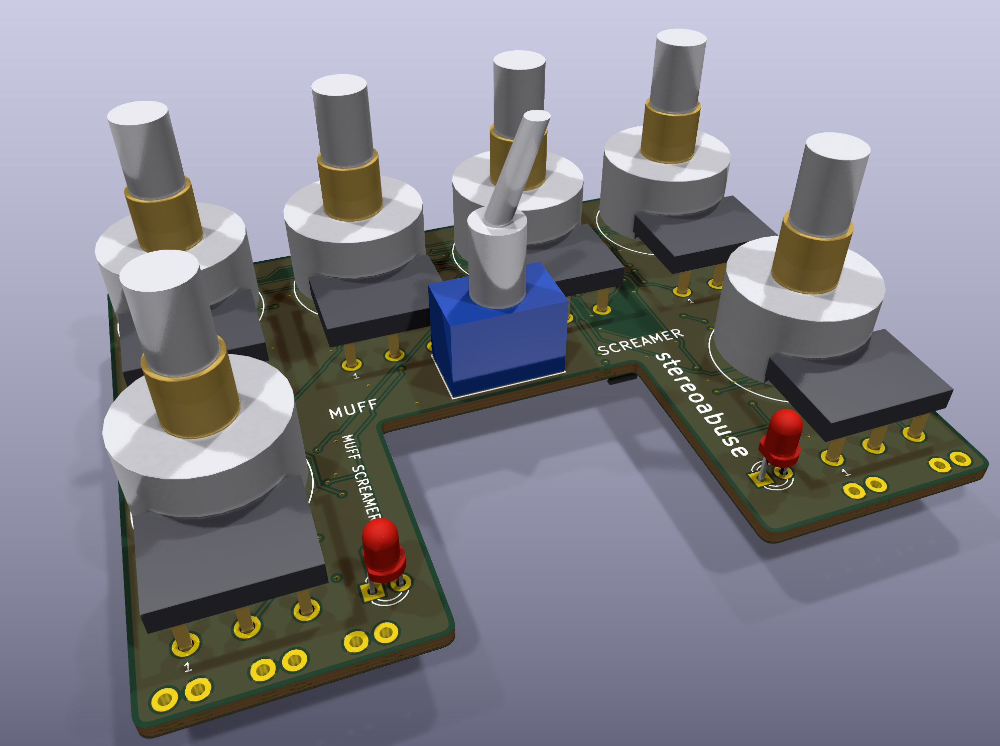
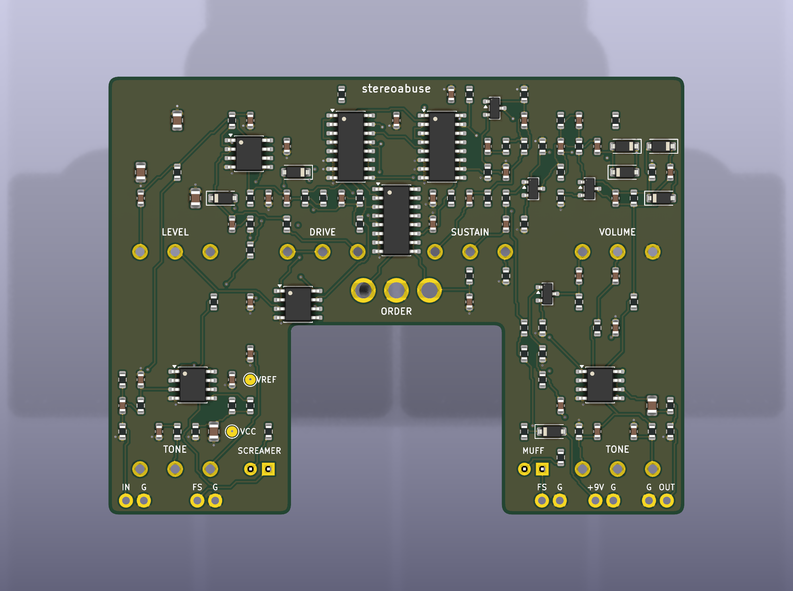
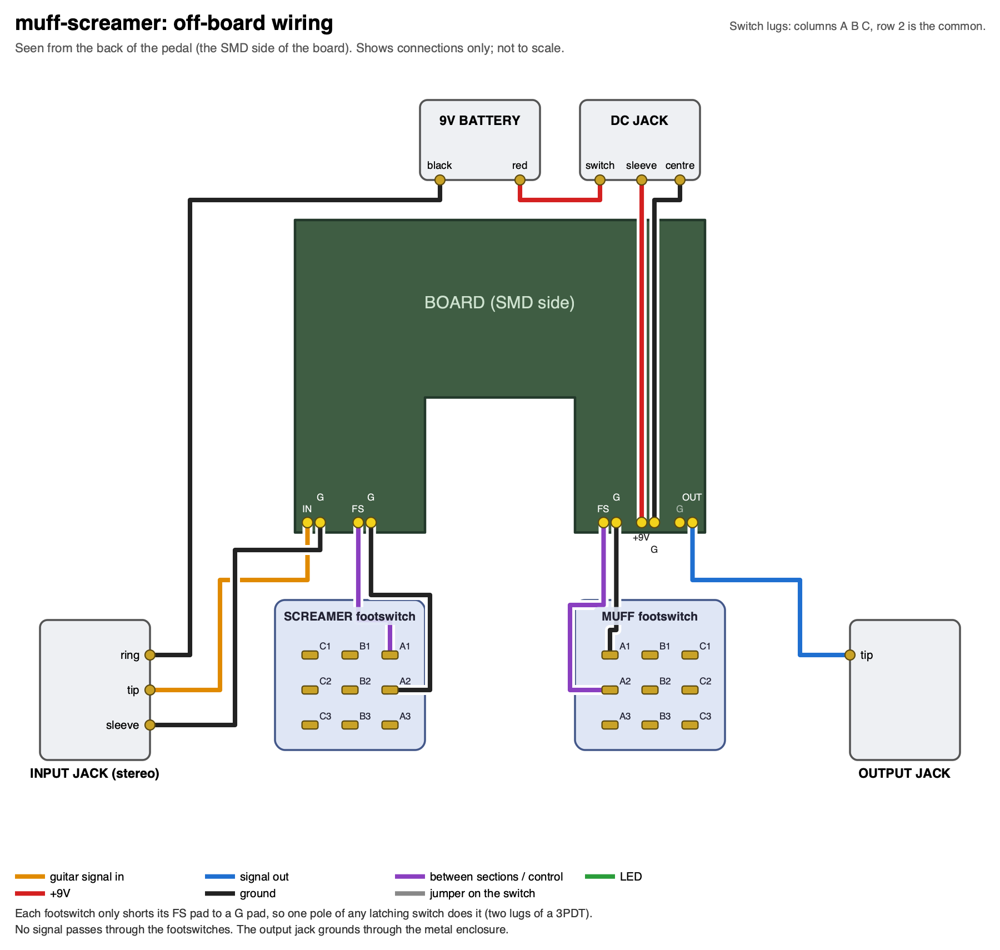

# muff-screamer

A black Russian Big Muff and a TS808 Tube Screamer on one board, by stereoabuse. Each has its own footswitch and its own three knobs. A toggle sets how they connect: Screamer into Muff, both in parallel, or Muff into Screamer.

Commands below are run from inside this folder. Untested hardware: the circuit is simulated and the board passes KiCad DRC, but no board has been built yet.

## What it is

| Control | Type | Notes |
|---|---|---|
| Drive | A500K pot | Screamer |
| Tone (Screamer) | W20K pot | The "TS tone" taper. B20K works but bunches the sweep at one end |
| Level | B100K pot | Screamer |
| Sustain | B100K pot | Muff |
| Tone (Muff) | B100K pot | Muff |
| Volume | B100K pot | Muff. Linear as in the original; A100K gives a smoother sweep |
| Order | SPDT on-off-on | Screamer into Muff, parallel, Muff into Screamer |
| Screamer | footswitch | Any latching switch |
| Muff | footswitch | Any latching switch |

How the two footswitches and the toggle combine:

| Toggle | Only Screamer on | Only Muff on | Both on |
|---|---|---|---|
| Screamer into Muff | Screamer | Muff | Screamer feeds the Muff |
| Parallel | Screamer | Muff | Both get the guitar, outputs are added |
| Muff into Screamer | Screamer | Muff | Muff feeds the Screamer |

Both off is bypass. The toggle only matters when both are on. In parallel the two outputs are added at full level, so both on is louder than either alone.

The Muff follows Kit Rae's trace of the V7C/V8 black Russian (bigmuffpage.com), with BC847C transistors in place of the BC547C. The Screamer is the stock TS808 circuit with a 720 Hz low cut. Two Screamer parts differ from the original and neither changes the sound: the 51 pF cap is 47 pF, and one bias resistor is 100k instead of 10k.

### Bypass is buffered, not true bypass

This is the main difference from the other pedals in this repo. Swapping the order of two true-bypass effects needs more switch poles than a toggle has, so the routing is done by three CD4053B analog switch chips, and the signal always passes through an input and an output buffer. Consequences:

- With no power (flat battery, no supply) the pedal passes no sound.
- Bypassed, the pedal is a unity-gain buffer. Simulated bypass loss is 0.2 dB or less.
- The footswitches carry no audio. Each only connects its FS pad to ground, so wiring is two wires per switch and any latching footswitch works.
- When the Muff is off its input is also disconnected, so it does not hiss or bleed into the bypassed signal.

Current draw is roughly 15 mA, so a 9 V alkaline battery should last a few tens of hours. That figure is an estimate from datasheet typicals, not a measurement.

## Ordering from JLCPCB

Files are in [fab/](fab/).

1. Upload `muff-screamer-revA-gerbers.zip`. Settings: 4 layers, 1.6 mm, 82 x 62.5 mm. Layer order is F, In1, In2, B (`.gtl`, `.g1`, `.g2`, `.gbl`).
2. Turn on PCB Assembly, top side.
3. Upload `muff-screamer-revA-bom.csv` and `muff-screamer-revA-cpl.csv`.
4. In the placement preview, check pin 1 on U1 to U7, the four transistors (Q1 to Q4), and the diode cathode bars. JLC's rotation convention differs from KiCad's for some packages; the CPL already applies the usual corrections, but this is the step to catch a mistake.

33 BOM lines, 110 placements. 4 of the lines are JLC "extended" parts (a small one-time fee each): CD4053B, BC847C, the 470 pF and the 3.9 nF capacitors. Stock was checked on 2026-11-12.

## Parts you solder

| Part | Qty | Notes |
|---|---|---|
| Alpha 16 mm right-angle PCB pot (RV16AF-41) | 6 | A500K, W20K, B100K x4 |
| Mini toggle, SPDT on-off-on | 1 | Solder lug or PC pin, 4.7 mm lug pitch |
| Latching footswitch | 2 | Wired, not board mounted. 3PDT is fine, only two lugs are used |
| 3 mm LED | 2 | Any colour |
| 1/4" jack | 2 | Input must be stereo (battery switching) |
| 2.1 mm DC jack with switch lug | 1 | Panel mount, insulated |
| 9V battery snap | 1 | |
| Hammond 1590BB enclosure | 1 | |

Pots, toggle and LEDs mount on the back of the board (the side with the pot outlines). Fit them loosely, bolt everything into the drilled enclosure, then solder, so the heights settle correctly.

Drill template (front view, 1:1): [docs/drill-template-1590BB.svg](docs/drill-template-1590BB.svg). Hole positions in mm from the face centre:

| Hole | x | y | dia |
|---|---|---|---|
| Volume (Muff) | -31.5 | +23.0 | 7.5 |
| Sustain (Muff) | -10.5 | +23.0 | 7.5 |
| Drive (Screamer) | +10.5 | +23.0 | 7.5 |
| Level (Screamer) | +31.5 | +23.0 | 7.5 |
| Order toggle | 0.0 | +1.5 | 6.5 |
| Tone (Muff) | -31.5 | -8.0 | 7.5 |
| Tone (Screamer) | +31.5 | -8.0 | 7.5 |
| Muff LED | -19.5 | -24.0 | 3.2 |
| Screamer LED | +19.5 | -24.0 | 3.2 |
| Muff switch | -27.0 | -43.0 | 12.5 |
| Screamer switch | +27.0 | -43.0 | 12.5 |

Seen from the front, the Muff is the left half (three knobs, LED, footswitch) and the Screamer is the right half. The pot, toggle and LED positions are the same as on the two preamp boards, minus two toggles, so the same drilling jig works. The battery lies between the footswitches in the board's notch. That fit is snug: check it with a real battery before drilling.

Toggle positions as designed (seen from the front): lever left is Screamer into Muff, centre is parallel, lever right is Muff into Screamer. If the switch you buy works the other way round, turn it 180 degrees.

## Wiring

The diagram ([SVG](docs/wiring.svg)) shows every off-board wire.

Pads are labelled on the SMD side. Screamer leg: IN, G, FS, G. Muff leg: FS, G, +9V, G, G, OUT.

| From | To |
|---|---|
| Input jack tip | IN |
| Input jack sleeve | G (next to IN) |
| Output jack tip | OUT |
| Screamer footswitch, one pole (common and one throw) | FS and G on the Screamer leg |
| Muff footswitch, one pole (common and one throw) | FS and G on the Muff leg |
| DC jack sleeve | +9V |
| DC jack centre pin | G (next to +9V) |
| Battery red | DC jack switch lug |
| Battery black | Input jack ring lug |

The output jack grounds through the metal enclosure; the spare G pad next to OUT is there if you use an insulated jack. Closing a footswitch turns that effect on and lights its LED.

Use a regulated 9 V centre-negative supply only.

## Simulation results

From `sim/from_design.py`, which builds the SPICE deck from the board netlist:

- All twelve combinations of toggle position and footswitch state route the signal as in the table above.
- Bypass: 0 dB, flat (0.2 dB loss in the Muff into Screamer position).
- Screamer: 15 to 35 dB of small-signal gain at 750 Hz across the Drive range, rolling off below 720 Hz.
- Muff: up to 55 dB of small-signal gain, with the usual mid scoop near 1 kHz at Tone noon.
- For a 0.2 V peak-to-peak input, the Screamer puts out up to 0.75 V and the Muff up to 1.5 V peak-to-peak with Level and Volume at maximum.

The switch chips are modelled as plain resistors, so switching pops and the chips' own distortion are not simulated.

## If something misbehaves

- Test pads: VCC should read about 8.6 V, VREF about 4.3 V.
- No sound at all: check power first, since bypass needs it.
- An LED lights but the effect does not switch: check that FS reads near 0 V with the switch closed and near VCC with it open.
- Squeal with Sustain and Drive both high and the Muff after the Screamer: that is a lot of gain in series (about 90 dB). Back off Drive or Level first.

## Schematic

[docs/schematic.pdf](docs/schematic.pdf), three sheets. It is drawn by `hw/schematic.py`, which extracts the connectivity of the drawing and refuses to write it unless every pin matches the board netlist. It is a drawing, not a KiCad schematic file.

| Sheet | Contents |
|---|---|
| [1](docs/schematic-1.png) | Power, buffers, routing switches, mixer, footswitch and toggle inputs |
| [2](docs/schematic-2.png) | Screamer |
| [3](docs/schematic-3.png) | Muff |

Regenerate with `uv run --with matplotlib python3 hw/schematic.py`.

## Scripts

Everything is generated from [hw/design.py](hw/design.py), which holds the full netlist with JLC part numbers.

| Step | Script |
|---|---|
| Simulate the netlist in ngspice | `sim/from_design.py` |
| Draw and verify the schematic | `hw/schematic.py` |
| Place parts | `hw/place.py` |
| Build the KiCad board | `hw/build_pcb.py` |
| Route (own grid router) | `hw/route.py` |
| Apply tracks, fill planes, DRC | `hw/apply_routes.py`, `hw/drc.sh` |
| Gerbers, BOM, CPL, renders | `hw/export.py` |
| Drill template | `hw/drill_template.py` |

`hw/make.sh` runs place through DRC. The board file is [hw/pedal.kicad_pcb](hw/pedal.kicad_pcb). Part positions with reference designators: [docs/assembly-smd-side.pdf](docs/assembly-smd-side.pdf).

## Things to check before paying

1. Open `hw/pedal.kicad_pcb` in KiCad and look it over.
2. Pot footprint: 3 pins at 5.0 mm pitch, 16 mm below the shaft, taken from the Alpha RV16AF-41 drawing. Confirm against the pots you buy.
3. Toggle lug pitch (4.7 mm) against the switch you buy.
4. Battery fit in the 1590BB.
5. The CD4053B pin assignment in `hw/design.py`. The A section (pins 12, 13, 14), the three commons, the select pins, INH, VEE, VSS and VDD were checked against a TI datasheet pin table. The B and C input pins (2/1 and 5/3, input 0 first) follow the standard 4053 pinout and were not confirmed the same way; compare them with the datasheet before ordering.
6. The TL072 is used on a single 9 V rail, as on the screamer board. It works at typical guitar levels but has little headroom on a tired battery.
7. The routing was done by a simple autorouter. It passes DRC with zero violations, but the Muff is a high-gain circuit and has not been tested for squeal on this layout.
