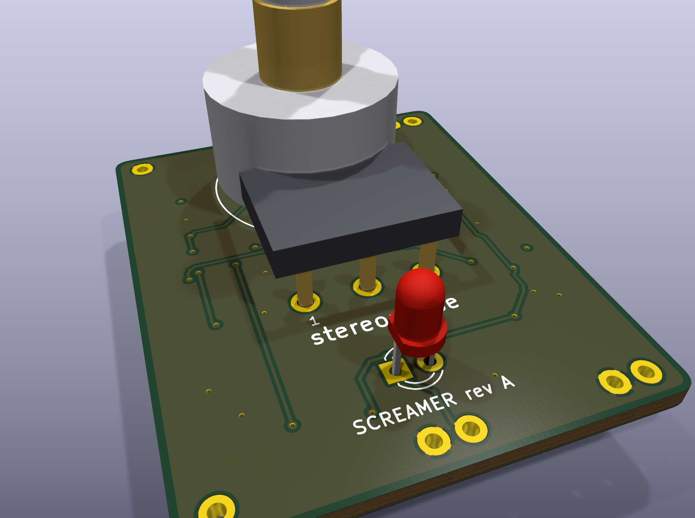
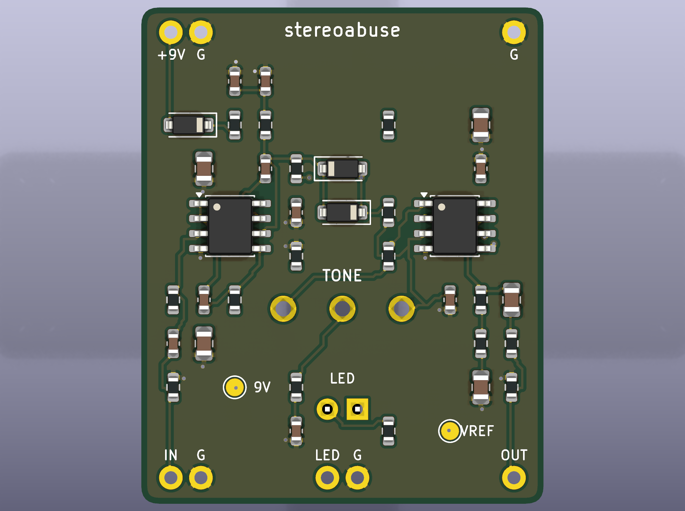

# screamer

One-knob overdrive by stereoabuse: a Tube Screamer with Drive fixed at zero and Level fixed at maximum, so the only control is Tone. It is meant as an always-ready tightening boost in front of an amp that is already distorting. Sibling designs are in [../preamp](../preamp) and [../boost-preamp](../boost-preamp). Commands below are run from inside this folder.

Rev A. Untested hardware: the circuit is simulated and the board passes KiCad DRC, but no board has been built yet.

## What it is

| Control | Type | Notes |
|---|---|---|
| Tone | W20K pot | The stock Tube Screamer tone control |
| Bypass | 3PDT footswitch | True bypass, wired by hand |

The voicing sits halfway between a stock Tube Screamer and a tightened one. Simulated gain in dB with Tone at noon:

| | 80 Hz | 300 Hz | 750 Hz | 2.5 kHz |
|---|---|---|---|---|
| Stock Tube Screamer | +3.7 | +12.5 | +15.7 | +10.6 |
| This pedal | +5.4 | +13.8 | +17.4 | +13.0 |

- The bass cut starts near 850 Hz (stock is 720 Hz).
- The output is about 2.5 dB hotter than a stock pedal with Level at maximum.
- The clipping diodes are stock, so it still clips lightly on hard picking, as a Tube Screamer does at zero Drive.
- Two op-amp followers replace the transistor buffers of the original.
- It runs on 9 V only (battery or supply). There is no charge pump.

## Ordering from JLCPCB

Files are in [fab/](fab/).

1. Upload `screamer-revA-gerbers.zip`. Settings: 4 layers, 1.6 mm, 34 x 42 mm. Layer order is F, In1, In2, B (`.gtl`, `.g1`, `.g2`, `.gbl`).
2. Turn on PCB Assembly, top side.
3. Upload `screamer-revA-bom.csv` and `screamer-revA-cpl.csv`.
4. In the placement preview, check pin 1 on U1 and U2 and the cathode bars on D1, D2, D3. The CPL applies the usual rotation corrections, but this is the step to catch a mistake.

21 BOM lines, 35 placements, all from JLC's basic library (no extended-part fees). Stock was checked on 2026-11-12.

## Parts you solder

| Part | Qty | Notes |
|---|---|---|
| Alpha 16 mm right-angle PCB pot (RV16AF-41), W20K | 1 | Sold as "20K W" or "TS tone" taper. B20K or B25K also works, but then nearly all the change happens in the last quarter turn |
| 3PDT footswitch | 1 | Wired, not board mounted |
| 3 mm LED | 1 | Any colour |
| 1/4" jack | 2 | Input must be stereo (battery switching) |
| 2.1 mm DC jack with switch lug | 1 | Panel mount, insulated |
| 9V battery snap | 1 | |
| Hammond 1590B2 enclosure | 1 | The tall version of the 1590B, 33.5 mm inside |

The pot and LED mount on the back of the board (the side with the pot outline). The pot is the only thing holding the board, which is fine at this size.

## Enclosure layout

Drill template (front view, 1:1): [docs/drill-template-1590B2.svg](docs/drill-template-1590B2.svg). Hole positions in mm from the face centre:

| Hole | x | y | dia |
|---|---|---|---|
| Tone | 0.0 | +10.0 | 7.5 |
| LED | 0.0 | -14.5 | 3.2 |
| Footswitch | 0.0 | -40.0 | 12.5 |

Jacks and the DC socket go on the top end wall: a jack about 19 mm either side of centre and the DC socket in the centre. Mark those from the parts you buy.

The battery lies flat behind the board, between the board and the back plate, with its snap end toward the jacks. How the depth adds up:

| Layer | Depth |
|---|---|
| Face to board (pot body) | about 10.7 mm |
| Board | 1.6 mm |
| Tallest SMD part | about 1.8 mm |
| Battery | 17.5 mm |
| Total | about 31.6 mm of the 33.5 mm available |

A 9V battery has a metal case and it rests against the populated side of the board. Put a layer of insulating tape or thin foam between them.

The footswitch is not on the board. A footswitch body is 13 to 17 mm deep and the pot holds the board about 11 mm behind the face, so the two cannot share one flat board.

## Wiring

Pads are labelled on the SMD side. Top edge: +9V, G on one corner and a spare G on the other. Bottom edge: IN, G, LED, G, OUT.

Footswitch (3PDT, columns A B C, row 2 is the common):

| Lug | Goes to |
|---|---|
| A1 | board IN |
| A2 | input jack tip |
| A3 | wire to B3 |
| B1 | board OUT |
| B2 | output jack tip |
| C1 | board LED |
| C2 | board G |
| C3 | board IN (grounds the input when bypassed) |

Power: DC jack centre pin to G, DC jack sleeve to +9V, battery red to the DC jack switch lug, battery black to the input jack ring lug, input jack sleeve to G.

Use a 9 V centre-negative supply. The op-amps are rated well above that, but the 10 uF capacitors are 25 V parts, so do not go above 18 V.

Test pads: 9V should read about 8.7 V and VREF about half that.

## How the board was made

Everything is generated from [hw/design.py](hw/design.py), which holds the full netlist with JLC part numbers.

Schematic: [docs/schematic.pdf](docs/schematic.pdf) ([image](docs/schematic-1.png)). It is drawn by `hw/schematic.py`, which refuses to write the drawing unless every pin matches the board netlist. Regenerate with `uv run --with matplotlib python3 hw/schematic.py`.

| Step | Script |
|---|---|
| Simulate the netlist in ngspice | `sim/from_design.py` |
| Draw and verify the schematic | `hw/schematic.py` |
| Place parts | `hw/place.py` |
| Build the KiCad board | `hw/build_pcb.py` |
| Route (own grid router) | `hw/route.py` |
| Apply tracks, fill planes, DRC | `hw/apply_routes.py`, `hw/drc.sh` |
| Gerbers, BOM, CPL, renders | `hw/export.py` |
| Drill template | `hw/drill_template.py` |

`hw/make.sh` runs place through DRC. The board file is [hw/pedal.kicad_pcb](hw/pedal.kicad_pcb).

## Things to check before paying or drilling

1. Open `hw/pedal.kicad_pcb` in KiCad and look it over.
2. The depth stack above. The pot height (10.7 mm) is from the Alpha drawing as modelled for the other two boards; measure your pot. There is about 2 mm to spare.
3. Top-mounted jacks in a 60 mm wide box are tight. Check that your two jacks and the DC socket fit side by side, and that the jacks do not reach down as far as the battery (it ends about 32 mm below the inside of the top wall).
4. Pot footprint: 3 pins at 5.0 mm pitch, 16 mm below the shaft.
5. The simulation uses a linear tone pot, so the tone sweep with the W taper is not modelled.
